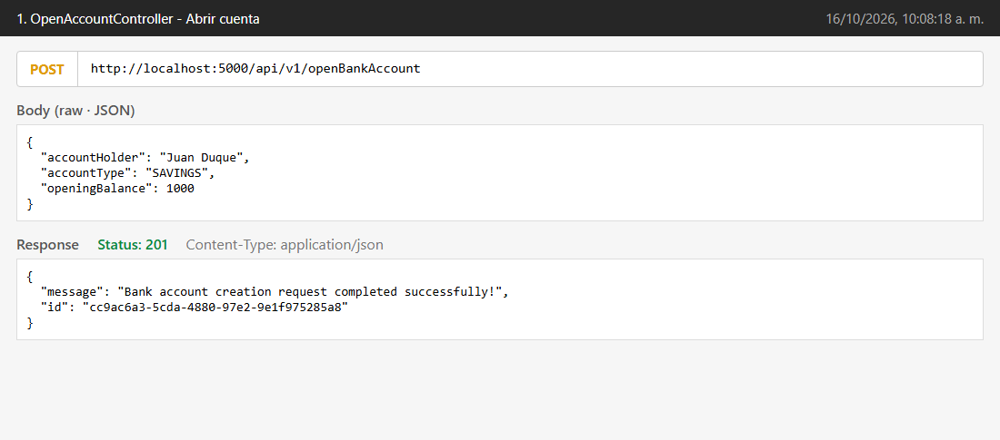
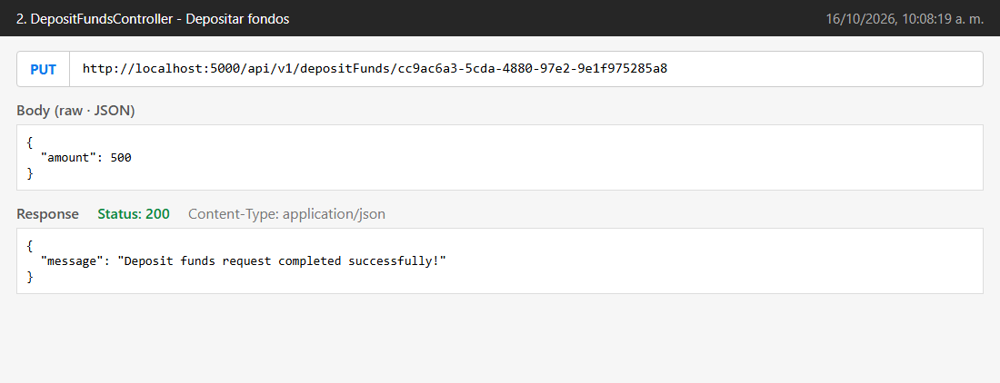
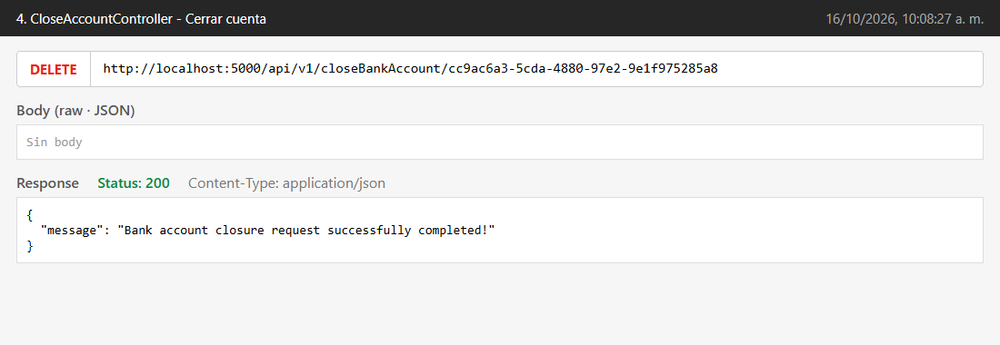
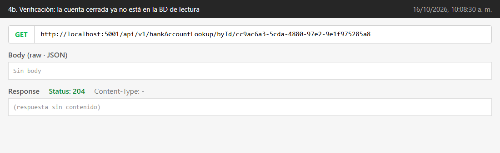
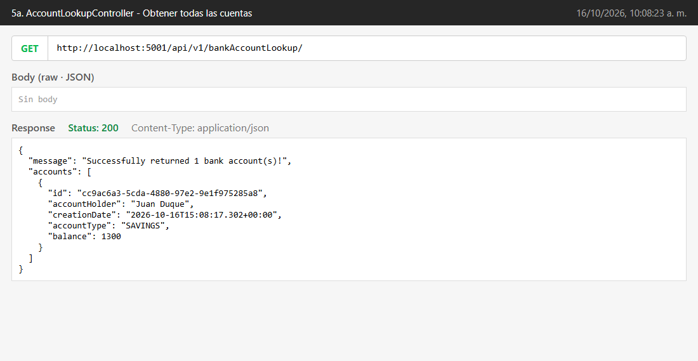
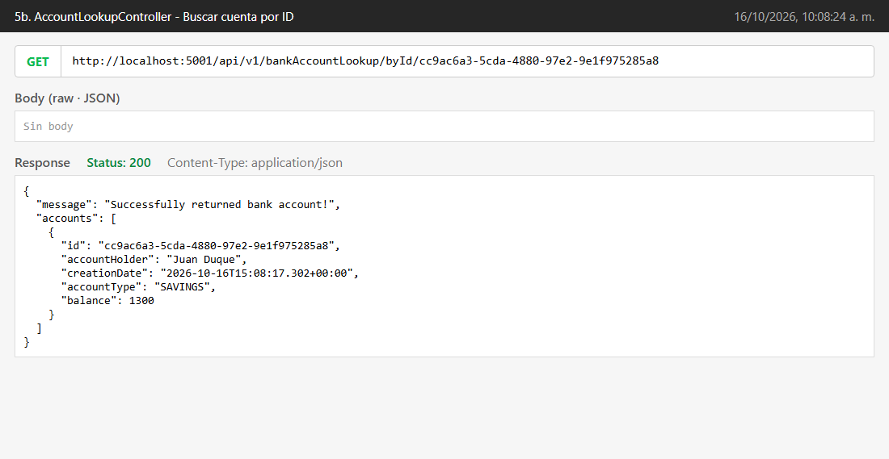
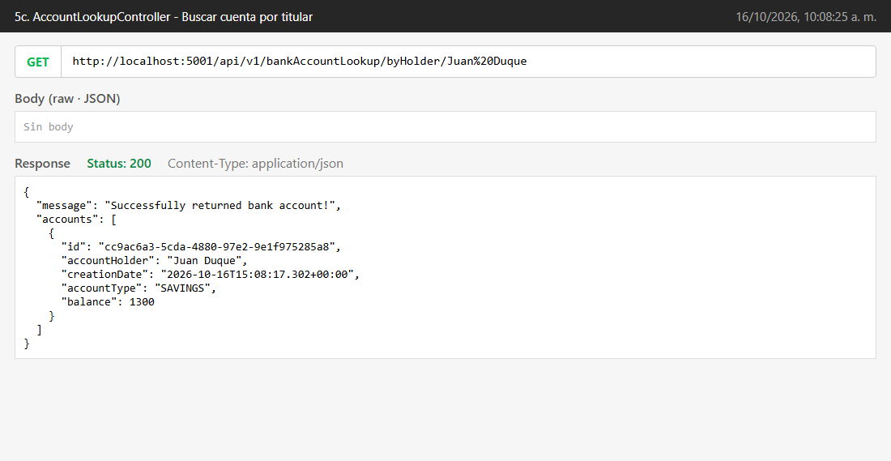
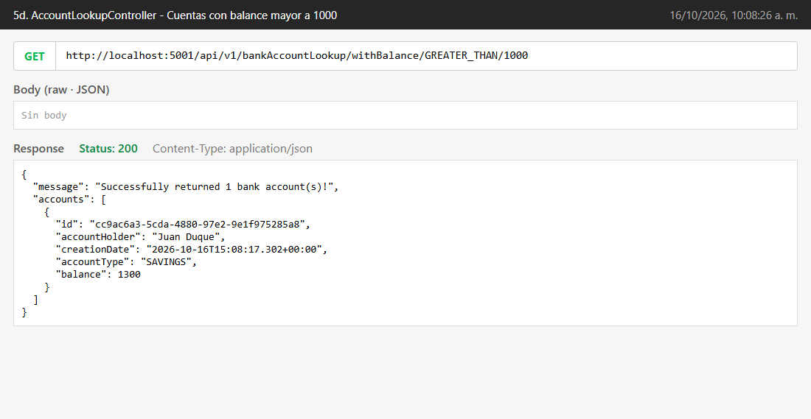
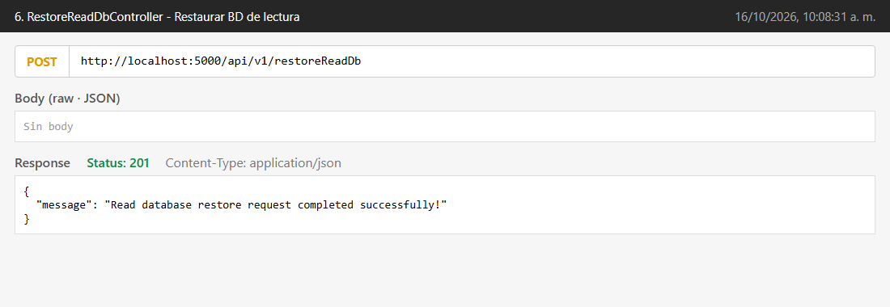

# Tarea: Prueba de Endpoints y Guarantee Event Consume Order en CQRS y Event Sourcing

**Autor:** Juan Esteban Duque

## Entorno de pruebas

| Componente | Detalle |
|---|---|
| Command API (`account.cmd`) | `http://localhost:5000` — Event Store en MongoDB |
| Query API (`account.query`) | `http://localhost:5001` — BD de lectura en MySQL |
| Mensajería | Apache Kafka (`localhost:29092`) |
| Infraestructura | `docker compose up -d` con el [docker-compose.yml](../docker-compose.yml) de la raíz |
| Java / Maven | JDK 21, Maven 3.9 (`mvn clean install` desde `bank-account/`) |

Ajustes necesarios para ejecutar el proyecto original:

- **Lombok 1.18.34** (`<lombok.version>` en los 4 `pom.xml`): la versión que trae Spring Boot 2.4.5 (1.18.20) no compila con JDK 21.
- **Bug corregido en `AccountEventHandler.on(FundsWithdrawnEvent)`**: calculaba el nuevo saldo pero nunca lo asignaba (`setBalance`), así que los retiros no se reflejaban en la BD de lectura.

---

# Parte 1: Prueba de Endpoints

Secuencia ejecutada: abrir cuenta → depositar 500 → retirar 200 → consultas (saldo esperado 1000 + 500 − 200 = **1300**) → cerrar cuenta → restaurar BD de lectura.

### 1. OpenAccountController — abrir cuenta

- **POST** `http://localhost:5000/api/v1/openBankAccount`
- Body:
```json
{ "accountHolder": "Juan Duque", "accountType": "SAVINGS", "openingBalance": 1000 }
```
- Respuesta `201 Created` con el ID generado de la cuenta (`cc9ac6a3-5cda-4880-97e2-9e1f975285a8`).



### 2. DepositFundsController — depositar fondos

- **PUT** `http://localhost:5000/api/v1/depositFunds/{id}`
- Body: `{ "amount": 500 }`
- Respuesta `200 OK`.



### 3. WithdrawFundsController — retirar fondos

- **PUT** `http://localhost:5000/api/v1/withdrawFunds/{id}`
- Body: `{ "amount": 200 }`
- Respuesta `200 OK`.


### 4. CloseAccountController — cerrar cuenta

- **DELETE** `http://localhost:5000/api/v1/closeBankAccount/{id}`
- Sin body. Respuesta `200 OK`.



Verificación: después del cierre, la consulta por ID responde `204 No Content` porque el `AccountClosedEvent` eliminó la cuenta de la BD de lectura.



### 5. AccountLookupController — consultas (antes del cierre)

**a. Obtener todas las cuentas:** **GET** `http://localhost:5001/api/v1/bankAccountLookup/`



**b. Buscar cuenta por ID:** **GET** `http://localhost:5001/api/v1/bankAccountLookup/byId/{id}` (saldo 1300, correcto)



**c. Buscar cuenta por titular:** **GET** `http://localhost:5001/api/v1/bankAccountLookup/byHolder/Juan Duque`



**d. Buscar cuentas con un balance específico:** **GET** `http://localhost:5001/api/v1/bankAccountLookup/withBalance/GREATER_THAN/1000`
(`equalityType` acepta `GREATER_THAN` o `LESS_THAN`)



### 6. RestoreReadDbController — restaurar BD de lectura

- **POST** `http://localhost:5000/api/v1/restoreReadDb`
- Sin body. Respuesta `201 Created`. Vuelve a publicar en Kafka los eventos del Event Store de las cuentas activas.



---

# Parte 2: Guarantee Event Consume Order

## El problema

En el diseño original cada tipo de evento se publicaba en **su propio topic** (`AccountOpenedEvent`, `FundsDepositedEvent`, `FundsWithdrawnEvent`, `AccountClosedEvent`) y el consumidor tenía un `@KafkaListener` por topic. Kafka solo garantiza el orden **dentro de una partición de un topic**; entre topics distintos no hay ningún orden. Al reproducir el Event Store, un `FundsDepositedEvent` podía consumirse antes que el `AccountOpenedEvent` de la misma cuenta. Como la cuenta todavía no existía en la BD de lectura, el handler descartaba el depósito y el estado reconstruido quedaba mal.


## Cambios realizados

### A. Lado de comandos (`account.cmd`)

**1. `application.yml`:** se agrega el topic único.
```yaml
  kafka:
    producer:
      ...
    topic: BankAccountEvents
```

**2. `AccountEventStore`:** se inyecta el topic y se publica ahí en vez de usar el nombre de la clase del evento.
```java
@Value("${spring.kafka.topic}")
private String topic;
...
eventProducer.produce(topic, event);   // antes: event.getClass().getSimpleName()
```

**3. `AccountEventSourcingHandler`:** el mismo cambio en `republishEvents()`, que usa el endpoint de restauración.
```java
@Value("${spring.kafka.topic}")
private String topic;
...
eventProducer.produce(topic, event);
```

### B. Lado de consultas (`account.query`)

**1. `application.yml`:** topic único y `poll-timeout` de 15 minutos.
```yaml
  kafka:
    topic: BankAccountEvents
    listener:
      ack-mode: MANUAL_IMMEDIATE
      poll-timeout: 900000
```

**2. `EventConsumer`:** los 4 métodos `consume` específicos se reemplazan por uno solo.
```java
public interface EventConsumer {
    void consume(@Payload BaseEvent event, Acknowledgment ack);
}
```

**3. `AccountEventConsumer`:** un único `@KafkaListener` sobre el topic de la configuración. Usa reflexión para invocar el método `on(...)` del `EventHandler` que corresponde al tipo concreto del evento. Se agregó una línea de log para evidenciar el orden de consumo.
```java
@KafkaListener(topics = "${spring.kafka.topic}", groupId = "${spring.kafka.consumer.group-id}")
@Override
public void consume(@Payload BaseEvent event, Acknowledgment ack) {
    try {
        logger.info(MessageFormat.format("Consumed {0} - account: {1}, version: {2}",
                event.getClass().getSimpleName(), event.getId(), event.getVersion()));
        var eventHandlerMethod = eventHandler.getClass().getDeclaredMethod("on", event.getClass());
        eventHandlerMethod.setAccessible(true);
        eventHandlerMethod.invoke(eventHandler, event);
        ack.acknowledge();
    } catch (Exception e) {
        throw new RuntimeException("Error while consuming event", e);
    }
}
```
El `JsonSerializer` del productor agrega el header `__TypeId__` con la clase concreta. Gracias a eso, el `JsonDeserializer` reconstruye el subtipo correcto aunque el parámetro sea `BaseEvent`.


## Prueba de la implementación

### Serie de operaciones

Se intercalaron operaciones de dos cuentas para que el orden fuera significativo:

| # | Operación | Cuenta | Captura |
|---|---|---|---|
| 1 | Abrir (1000) | Ana | [01](capturas/parte2/01-open-account-ana.png) |
| 2 | Abrir (300) | Luis | [02](capturas/parte2/02-open-account-luis.png) |
| 3 | Depositar 500 | Ana | [03](capturas/parte2/03-deposit-ana.png) |
| 4 | Depositar 200 | Luis | [04](capturas/parte2/04-deposit-luis.png) |
| 5 | Retirar 250 | Ana | [05](capturas/parte2/05-withdraw-ana.png) |
| 6 | Retirar 100 | Luis | [06](capturas/parte2/06-withdraw-luis.png) |
| 7 | Cerrar | Luis | [07](capturas/parte2/07-close-luis.png) |

Logs del servicio de consulta durante las operaciones: un solo listener consume todo, en el orden exacto de producción.


Todos los eventos quedaron en la única partición del topic `BankAccountEvents`, con offsets consecutivos 0–6:


Estado de la BD de lectura antes del reinicio (solo queda Ana con 1250, porque Luis cerró su cuenta):


### Reinicio del servicio de consulta y reproducción de eventos

1. Se detuvo `account.query`.
2. Se borró la BD de lectura (`DROP DATABASE bankAccount`) y se reinició el offset del grupo `bankaccConsumer` al inicio del topic (`--reset-offsets --to-earliest`).
3. Se volvió a iniciar `account.query`.


Al arrancar, el consumidor reprodujo los 7 eventos **en el mismo orden** en que se produjeron:


La BD de lectura quedó reconstruida desde cero con el estado correcto (Ana: 1000 + 500 − 250 = 1250; Luis no aparece porque su `AccountClosedEvent` se aplicó al final):


## ¿Cómo se garantiza el orden y por qué es importante?

**Cómo se garantiza:** Kafka asigna a cada mensaje de una partición un offset creciente, y un consumidor lee esa partición estrictamente en orden de offset. Al publicar **todos** los eventos en un solo topic (`BankAccountEvents`, con una partición), todos comparten la misma secuencia de offsets. El orden de consumo coincide entonces con el orden en que el Event Store guardó y publicó los eventos. Además, un único método `consume` atiende todos los tipos de evento, así que no hay varios listeners leyendo en paralelo topics independientes. El `ack-mode: MANUAL_IMMEDIATE` confirma el offset solo después de aplicar el evento: si algo falla, no se salta ningún evento.

**Por qué es importante:** en Event Sourcing el estado es el resultado de aplicar los eventos **en secuencia**. Las operaciones no son conmutativas: un depósito antes de que exista la cuenta se pierde, y un cierre antes de un retiro deja datos inconsistentes. En CQRS la BD de lectura se construye solo a partir de esos eventos, y se debe poder reconstruir en cualquier momento (restauración, nuevo servicio de consulta, recuperación ante fallos). Sin orden garantizado, cada replay podría producir un estado distinto y la BD de lectura dejaría de ser una proyección fiel del Event Store.

> Nota: con un topic de una sola partición el orden es total. Si se necesitara escalar a varias particiones, el orden se mantendría **por cuenta** usando el ID del agregado como *key* del mensaje: Kafka envía todos los mensajes con la misma key a la misma partición.
