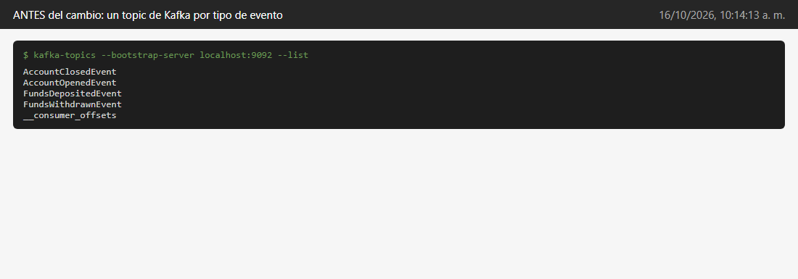
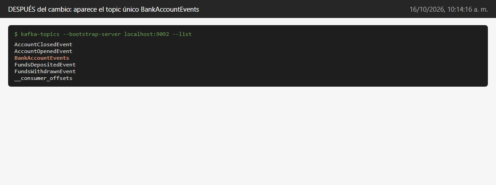

# Entregable 2: Cambios para garantizar el orden de consumo de eventos

Juan Esteban Duque

## Cuál era el problema

En el proyecto original cada tipo de evento se mandaba a un topic distinto de Kafka: había uno para AccountOpenedEvent, otro para FundsDepositedEvent, otro para FundsWithdrawnEvent y otro para AccountClosedEvent. Y en el servicio de consultas había un listener por cada topic.

Kafka respeta el orden de los mensajes dentro de un mismo topic, pero entre topics diferentes no hay ningún orden. Entonces, si se reconstruye la base de lectura, puede pasar que llegue primero el depósito de una cuenta y después la apertura. Como la cuenta todavía no existe cuando llega el depósito, ese depósito se ignora y el saldo queda mal.

Así se veían los topics antes del cambio:



La solución es mandar todos los eventos a un solo topic. Así todos quedan en la misma fila, uno detrás del otro, y se leen en el mismo orden en que pasaron.

## Cambios en el servicio de comandos (account.cmd)

En el application.yml agregué el nombre del topic:

```yaml
  kafka:
    topic: BankAccountEvents
```

En AccountEventStore agregué un atributo que lee ese nombre del yml, y cambié la línea donde se publica el evento. Antes se usaba el nombre de la clase del evento como topic, ahora se usa siempre el mismo:

```java
@Value("${spring.kafka.topic}")
private String topic;

eventProducer.produce(topic, event);
```

En AccountEventSourcingHandler hice el mismo cambio, en el método republishEvents, que es el que usa el endpoint de restaurar la base de lectura.

## Cambios en el servicio de consultas (account.query)

En el application.yml puse el mismo topic y subí el poll-timeout a 900000 (15 minutos), como decía la guía, para que el consumidor no se desconecte si uno se queda depurando:

```yaml
  kafka:
    topic: BankAccountEvents
    listener:
      ack-mode: MANUAL_IMMEDIATE
      poll-timeout: 900000
```

En la interfaz EventConsumer quité los cuatro métodos consume (uno por evento) y dejé uno solo que recibe un BaseEvent, que es la clase padre de todos los eventos:

```java
void consume(@Payload BaseEvent event, Acknowledgment ack);
```

En AccountEventConsumer dejé un solo @KafkaListener escuchando el topic nuevo. Como ahora llega cualquier tipo de evento por el mismo método, se usa reflexión para buscar el método `on` del EventHandler que corresponde a ese tipo de evento y llamarlo. Le agregué una línea de log para poder ver en consola en qué orden llegan los eventos, que es lo que pide la tarea:

```java
@KafkaListener(topics = "${spring.kafka.topic}", groupId = "${spring.kafka.consumer.group-id}")
@Override
public void consume(@Payload BaseEvent event, Acknowledgment ack) {
    try {
        logger.info(MessageFormat.format("Consumed {0} - account: {1}, version: {2}",
                event.getClass().getSimpleName(), event.getId(), event.getVersion()));
        var eventHandlerMethod = eventHandler.getClass().getDeclaredMethod("on", event.getClass());
        eventHandlerMethod.setAccessible(true);
        eventHandlerMethod.invoke(eventHandler, event);
        ack.acknowledge();
    } catch (Exception e) {
        throw new RuntimeException("Error while consuming event", e);
    }
}
```

Una duda que tuve fue cómo sabe Kafka de qué clase es cada evento si el método recibe un BaseEvent. Resulta que al publicar, el serializador JSON le pone al mensaje un header con el nombre de la clase real, y al leerlo el deserializador usa ese header para armar el objeto correcto.

Después del cambio ya aparece el topic BankAccountEvents. Los topics viejos siguen ahí porque tienen los eventos de antes, pero ya no se usan:



## Por qué esto garantiza el orden y por qué importa

Kafka le pone a cada mensaje de un topic un número consecutivo (el offset) y el consumidor los lee en ese orden. Si todo va al mismo topic, todos los eventos comparten la misma numeración y se consumen exactamente en el orden en que se guardaron. Además, con el ack manual el offset solo se confirma después de procesar el evento, así que si algo falla no se salta ninguno.

Esto importa porque en Event Sourcing el estado de una cuenta no se guarda directamente, sino que sale de aplicar todos sus eventos uno por uno. No da lo mismo el orden: no se puede depositar en una cuenta que no se ha abierto, ni retirar de una que ya se cerró. Y en CQRS la base de lectura se arma solo con esos eventos, así que si llegan desordenados la base de lectura termina diciendo algo distinto a lo que de verdad pasó.

Una cosa que quedé pensando: con un solo topic y una sola partición todo queda en orden, pero si el sistema creciera y se necesitaran varias particiones, habría que usar el id de la cuenta como llave del mensaje. Así todos los eventos de una misma cuenta caen en la misma partición y por lo menos el orden de cada cuenta se mantiene.
