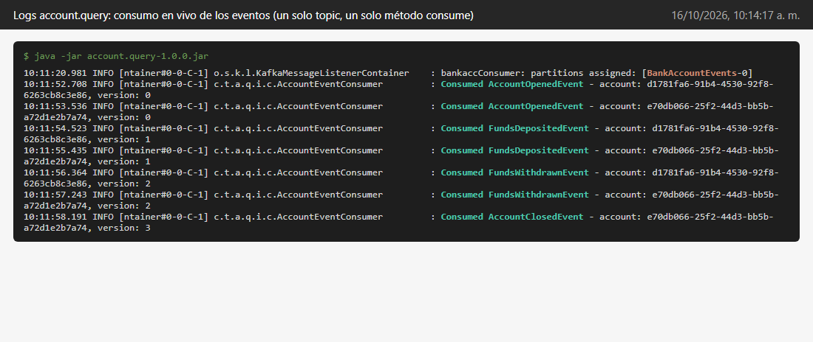
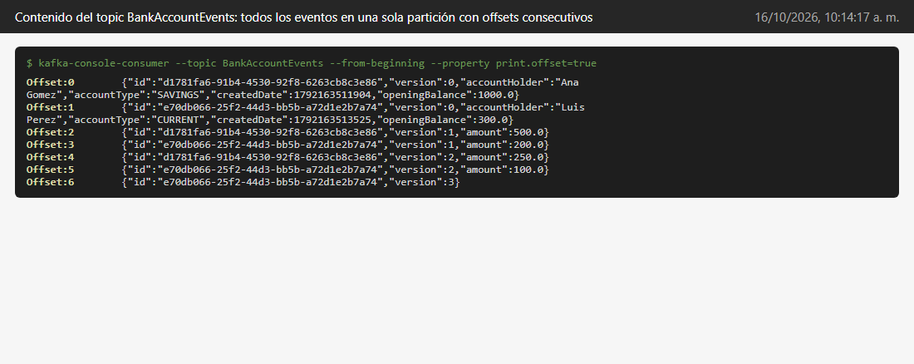
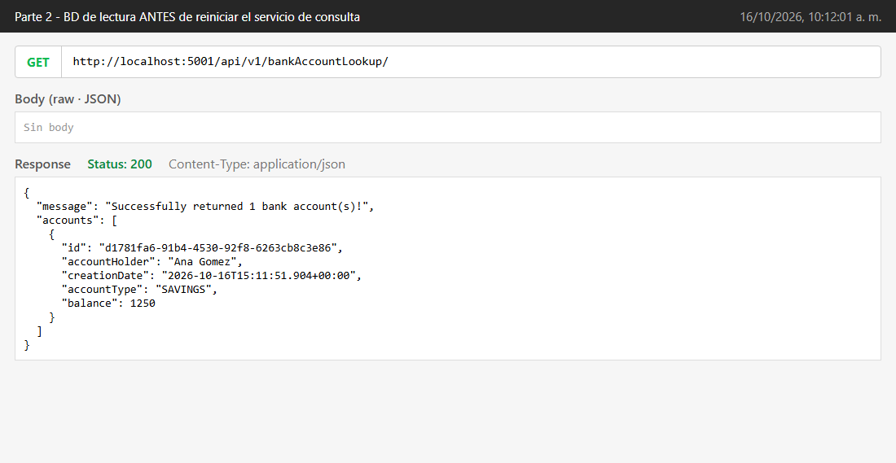
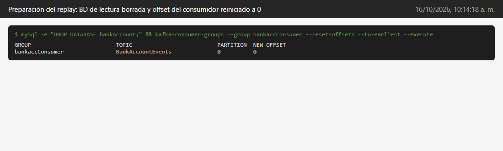
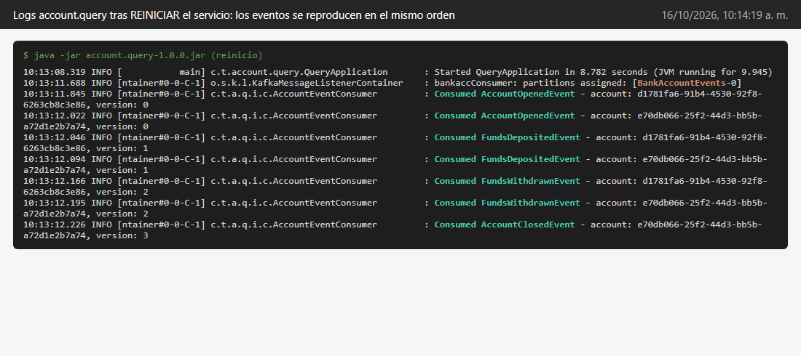
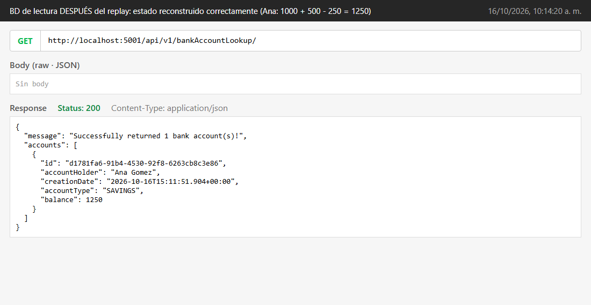

# Entregable 3: Prueba de reproducción de eventos

Juan Esteban Duque

## Operaciones que hice

Para que la prueba del orden tuviera sentido usé dos cuentas y fui intercalando las operaciones, así se nota si algún evento llega cruzado:

| Paso | Operación | Cuenta |
|---|---|---|
| 1 | Abrir con 1000 | Ana |
| 2 | Abrir con 300 | Luis |
| 3 | Depositar 500 | Ana |
| 4 | Depositar 200 | Luis |
| 5 | Retirar 250 | Ana |
| 6 | Retirar 100 | Luis |
| 7 | Cerrar | Luis |

Las capturas de cada petición están en la carpeta [capturas/parte2](capturas/parte2) (de la 01 a la 07).

Al final la única cuenta activa debería ser la de Ana con 1000 + 500 - 250 = 1250, porque la de Luis se cerró.

## Logs mientras hacía las operaciones

En la consola del servicio de consultas se ve cómo fueron llegando los eventos. Llegaron en el mismo orden de la tabla:

También revisé directamente el topic en Kafka. Los 7 eventos quedaron uno detrás del otro con offsets del 0 al 6:

Y la base de lectura quedó como esperaba, solo Ana con 1250:

## Reinicio del servicio de consultas

Para ver la reproducción de eventos desde cero hice esto:

1. Apagué el servicio de consultas.
2. Borré la base de datos de lectura en MySQL, para que no quedara nada.
3. Le dije a Kafka que el grupo consumidor volviera a leer el topic desde el principio (reset de offsets a 0). Si no hacía esto, al reiniciar el servicio no pasaba nada, porque Kafka recuerda hasta dónde había leído.
4. Volví a prender el servicio.

Apenas arrancó, el servicio volvió a leer los 7 eventos y los procesó en el mismo orden de antes. Primero las dos aperturas, después los depósitos, los retiros y al final el cierre de Luis:

Consulté todas las cuentas y la base de lectura quedó igual que antes de borrarla: Ana con 1250 y Luis no aparece porque su cierre fue lo último que se aplicó.

## Conclusión

La prueba muestra que con un solo topic los eventos siempre se procesan en el orden en que ocurrieron, tanto cuando llegan en vivo como cuando se reproducen después de reiniciar. Por eso se puede borrar la base de lectura y volver a armarla desde los eventos sin perder información, que es justamente una de las ventajas de usar Event Sourcing con CQRS. Con la versión anterior, con un topic por evento, esto no estaba garantizado y el resultado podía cambiar cada vez que se reconstruyera.
